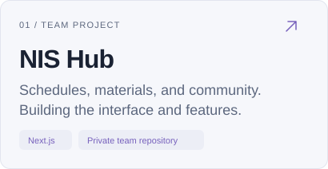
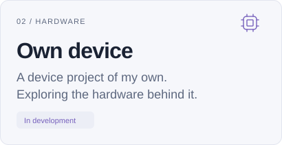
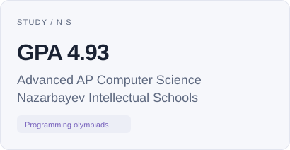
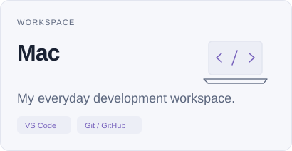

<picture>
  <source media="(prefers-color-scheme: dark)" srcset="assets/header-dark-v2.svg">
  <source media="(prefers-color-scheme: light)" srcset="assets/header-light-v2.svg">
  
</picture>

NIS student working on web applications and a device of my own. Learning through projects and programming olympiads.

## In progress

<a href="https://github.com/sNibaAdeka/snibagrades"><picture><source media="(prefers-color-scheme: dark)" srcset="assets/project-nis-dark.svg"><source media="(prefers-color-scheme: light)" srcset="assets/project-nis-light.svg"></picture></a>
<picture>
  <source media="(prefers-color-scheme: dark)" srcset="assets/project-device-dark.svg">
  <source media="(prefers-color-scheme: light)" srcset="assets/project-device-light.svg">
  
</picture>

More projects

- **[AquaGuardian](https://github.com/doniar4/AquaQuardian)** — an interface prototype for groundwater data in Kazakhstan.
- **[AboutMe](https://github.com/doniar4/AboutMe)** — a personal website for practising layout, design, and interactions.

## Study & workspace

<picture>
  <source media="(prefers-color-scheme: dark)" srcset="assets/study-dark.svg">
  <source media="(prefers-color-scheme: light)" srcset="assets/study-light.svg">
  
</picture>
<picture>
  <source media="(prefers-color-scheme: dark)" srcset="assets/workspace-dark.svg">
  <source media="(prefers-color-scheme: light)" srcset="assets/workspace-light.svg">
  
</picture>

## Toolbox

Tools I use and continue to learn.

**Web** &nbsp; `HTML` `CSS` `JavaScript` `TypeScript` `React` `Next.js` 
**Data & prototypes** &nbsp; `Python` `Supabase` `PostgreSQL` 
**Practice** &nbsp; algorithms · data structures · problem solving

## Contact

Project ideas, hackathons, or collaboration.

<a href="https://t.me/doniar4"><picture><source media="(prefers-color-scheme: dark)" srcset="assets/contact-telegram-dark-v2.svg"><source media="(prefers-color-scheme: light)" srcset="assets/contact-telegram-light-v2.svg"></picture></a>
<a href="https://www.instagram.com/_ddnr_4/"><picture><source media="(prefers-color-scheme: dark)" srcset="assets/contact-instagram-dark-v2.svg"><source media="(prefers-color-scheme: light)" srcset="assets/contact-instagram-light-v2.svg"></picture></a>

[Repositories](https://github.com/doniar4?tab=repositories) &nbsp; · &nbsp; [Portfolio source](https://github.com/doniar4/AboutMe)
