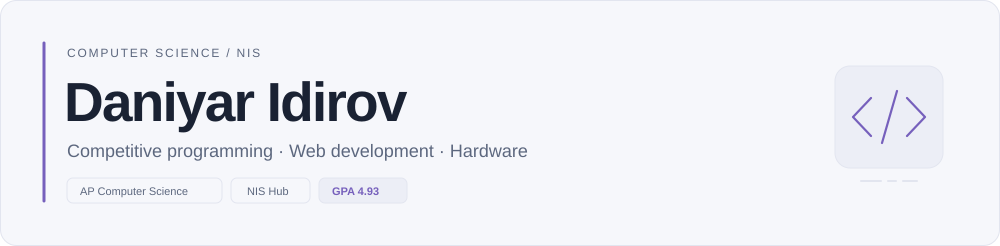
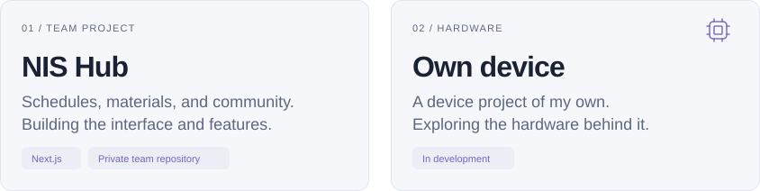
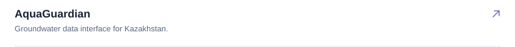
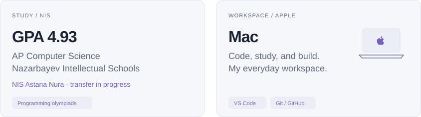

<picture>
  <source media="(prefers-color-scheme: dark)" srcset="assets/header-dark-v2.svg">
  <source media="(prefers-color-scheme: light)" srcset="assets/header-light-v2.svg">
  
</picture>

NIS student working on web applications and a device of my own. Learning through projects and programming olympiads.

## In progress

<picture><source media="(prefers-color-scheme: dark) and (max-width: 767px)" srcset="assets/building-v2-mobile-dark.svg"><source media="(prefers-color-scheme: light) and (max-width: 767px)" srcset="assets/building-v2-mobile-light.svg"><source media="(prefers-color-scheme: dark)" srcset="assets/building-v2-dark.svg"><source media="(prefers-color-scheme: light)" srcset="assets/building-v2-light.svg"></picture>

<picture><source media="(prefers-color-scheme: dark)" srcset="assets/project-index-dark.svg"><source media="(prefers-color-scheme: light)" srcset="assets/project-index-light.svg"></picture>

<a href="https://github.com/sNibaAdeka/snibagrades"><picture><source media="(prefers-color-scheme: dark) and (max-width: 767px)" srcset="assets/index-nis-mobile-dark.svg"><source media="(prefers-color-scheme: light) and (max-width: 767px)" srcset="assets/index-nis-mobile-light.svg"><source media="(prefers-color-scheme: dark)" srcset="assets/index-nis-dark.svg"><source media="(prefers-color-scheme: light)" srcset="assets/index-nis-light.svg"></picture></a>

<a href="https://github.com/doniar4/AquaQuardian"><picture><source media="(prefers-color-scheme: dark) and (max-width: 767px)" srcset="assets/index-aqua-mobile-dark.svg"><source media="(prefers-color-scheme: light) and (max-width: 767px)" srcset="assets/index-aqua-mobile-light.svg"><source media="(prefers-color-scheme: dark)" srcset="assets/index-aqua-dark.svg"><source media="(prefers-color-scheme: light)" srcset="assets/index-aqua-light.svg"></picture></a>

<a href="https://github.com/doniar4/AboutMe"><picture><source media="(prefers-color-scheme: dark) and (max-width: 767px)" srcset="assets/index-portfolio-mobile-dark.svg"><source media="(prefers-color-scheme: light) and (max-width: 767px)" srcset="assets/index-portfolio-mobile-light.svg"><source media="(prefers-color-scheme: dark)" srcset="assets/index-portfolio-dark.svg"><source media="(prefers-color-scheme: light)" srcset="assets/index-portfolio-light.svg"></picture></a>

## Study & workspace

<picture><source media="(prefers-color-scheme: dark) and (max-width: 767px)" srcset="assets/study-workspace-v2-mobile-dark.svg"><source media="(prefers-color-scheme: light) and (max-width: 767px)" srcset="assets/study-workspace-v2-mobile-light.svg"><source media="(prefers-color-scheme: dark)" srcset="assets/study-workspace-v2-dark.svg"><source media="(prefers-color-scheme: light)" srcset="assets/study-workspace-v2-light.svg"></picture>

## Toolbox

01 <strong>Web development</strong> HTML · CSS · JavaScript · TypeScript React · Next.js

02 <strong>Data &amp; prototypes</strong> Python · Supabase · PostgreSQL

03 <strong>Problem solving</strong> Algorithms · data structures · mathematics

Tools I use and continue to learn.

## Contact me

<strong>Open to ideas and collaboration.</strong> Have a project, a hackathon, or something worth building? Send me a message.

<a href="https://t.me/doniar4"><picture><source media="(prefers-color-scheme: dark)" srcset="assets/contact-telegram-flat-dark.svg"><source media="(prefers-color-scheme: light)" srcset="assets/contact-telegram-flat-light.svg"></picture></a>
<a href="https://www.instagram.com/_ddnr_4/"><picture><source media="(prefers-color-scheme: dark)" srcset="assets/contact-instagram-flat-dark.svg"><source media="(prefers-color-scheme: light)" srcset="assets/contact-instagram-flat-light.svg"></picture></a>

[All repositories ↗](https://github.com/doniar4?tab=repositories) &nbsp; · &nbsp; [Portfolio source ↗](https://github.com/doniar4/AboutMe)
