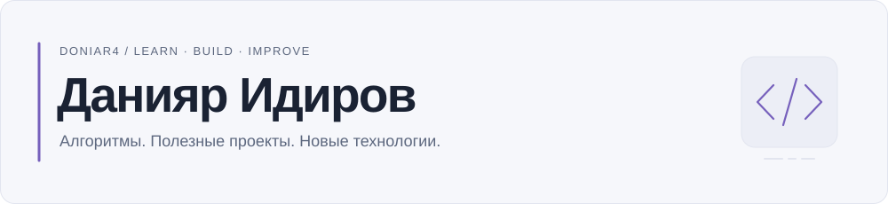

<picture>
  <source media="(prefers-color-scheme: dark)" srcset="assets/header-dark.svg">
  <source media="(prefers-color-scheme: light)" srcset="assets/header-light.svg">
  
</picture>

**Ученик НИШ · олимпиадное программирование · собственные проекты**

Привет, я Данияр, в сети — **doniar4**. Учусь на отлично, занимаюсь олимпиадным программированием и превращаю идеи в проекты. Сейчас развиваю **НИШ Хаб**, изучаю новые технологии и работаю над собственным устройством.

Student, olympiad programmer and project builder. Learning through algorithms, web development and hands-on projects.

## Сейчас в фокусе

- **НИШ Хаб.** Развиваю учебную платформу, которая объединяет школьные инструменты в одном месте: расписание, учебные материалы, задачи и общение.
- **Собственное устройство.** Работаю над устройством и изучаю технологии, которые нужны для его создания.
- **Новые технологии.** Осваиваю инструменты веб-разработки и пробую их в своих проектах — от интерфейса до работы с данными.

## Учёба и алгоритмы

Олимпиадные задачи — одна из моих главных точек роста. Развиваю алгоритмическое мышление, практикую **C++**, разбираю структуры данных и уделяю внимание математике.

Параллельно учусь на отлично и прохожу углублённый курс **AP Computer Science**. Хочу лучше понимать основы информатики и применять их за пределами учебных задач.

## Проекты

| Проект | Что делаю |
| :--- | :--- |
| **[НИШ Хаб](https://github.com/doniar4/NIS-Hub)** | Учебная платформа для школьной повседневности: материалы, расписание, личные задачи и сообщество. |
| **[AquaGuardian](https://github.com/doniar4/AquaQuardian)** | Прототип интерфейса для представления и анализа данных о подземных водах Казахстана. |
| **[AboutMe](https://github.com/doniar4/AboutMe)** | Личный сайт-портфолио, на котором практикую вёрстку, оформление и взаимодействие с интерфейсом. |

## Технологии

Инструменты, с которыми работаю и продолжаю разбираться:

**Алгоритмы** &nbsp; `C++` · структуры данных · решение задач 
**Web** &nbsp; `HTML` · `CSS` · `JavaScript` · `TypeScript` · `React` · `Next.js` 
**Данные и прототипы** &nbsp; `Python` · `Supabase` · `PostgreSQL` 
**Рабочий процесс** &nbsp; `Git` · `GitHub` · тестирование

Мне важны понятные интерфейсы и аккуратная разработка: собрать рабочую основу, проверить её и постепенно улучшать.

---

Интересны **совместные проекты, хакатоны и новые задачи**, в которых можно научиться чему-то на практике.

[Все репозитории →](https://github.com/doniar4?tab=repositories) &nbsp; · &nbsp; [Сайт-портфолио: исходники](https://github.com/doniar4/AboutMe)
